# TrustLine

**Privacy-first observability and AIOps for CICADA 2026.** A collector inside the customer's site keeps raw logs, payloads and secrets local. Only allow-listed, redacted, pseudonymous metadata crosses one mutual-TLS door to a multi-tenant SaaS. The SaaS turns that metadata into four-state health, correlated incidents and explainable, human-approved recommendations.

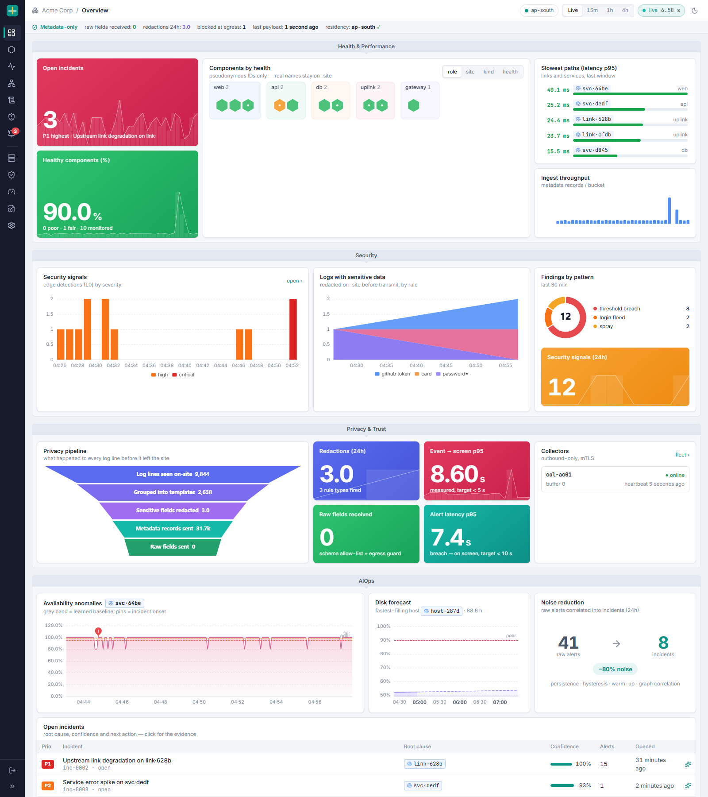

```
 TIER 1 - SITE (raw data never leaves)                         ║ H2 ║  TIER 2 - REGION ap-south (metadata only, multi-tenant)
                                                               ║mTLS║
 devices / organiser stream / simulator                        ║TLS ║
     │ H1 (push :8081, syslog :5514)                           ║1.3 ║
     ▼                                                         ║    ║
 collector  1 collect → 2 filter → 3 redact → 4 aggregate      ║    ║  nginx :8443 ─▶ ingest-api ─▶ NATS JetStream ─▶ writer ─▶ Postgres (RLS)
            → 5 analyse (L0 security, fast path) → 6 policy ═══╬════╬═▶ (cert = identity)  (dedupe by payload_id)   aiops L1-L5 ─▶ incidents
            (allow-list, egress guard) → 7 transmit (outbox)   ║    ║                                               health / sweeper ─▶ 4 states
     │                                                         ║    ║  api :8000 (JWT, tenant from token) ─▶ dashboard + AI Investigator
 raw.db · egress.db (hash chain) · outbox.db · state.db         ║    ║  control plane: tenant registry, CA, enrolment, revocation
 local UI :9090 (egress proof, raw vault, buffer, re-identify) ║    ║
```

## Contents

1. [Run it](#1-run-it): two laptops on a LAN, Colab + laptop, Docker, dashboard only
2. [Judge's questions, answered phase by phase](#2-judges-questions-answered-phase-by-phase)
3. [How every part works](#3-how-every-part-works)
4. [Specifications](#4-specifications)
5. [Limitations and what production needs](#5-limitations-and-what-production-needs)
6. [Repository rules](#6-repository-rules)

---

## 1. Run it

There are four ways to run TrustLine. All of them use the same code; only where the two tiers run changes.

| Mode | Tier 2 (SaaS) runs on | Tier 1 (site) runs on | Link between them |
|---|---|---|---|
| **A. LAN, two laptops** | your laptop (Windows or Linux) | a second laptop | Wi-Fi / hotspot, mTLS on :8443 |
| **B. Colab + laptop** | Google Colab VM | your laptop | `bore` TCP relay (TLS end to end) + `cloudflared` for the dashboard |
| **C. Docker** | containers | containers | a Docker network (`wan`) |
| **D. Dashboard only** | none (synthetic tenant in the browser) | none | none |

### A. LAN mode: your laptop is the SaaS, a second laptop is the site

Both laptops must be on the same Wi-Fi or phone hotspot. College and hotel Wi-Fi often blocks laptop-to-laptop traffic ("client isolation"); a phone hotspot always works.

**Server laptop (Tier 2), once:**

```powershell
git clone https://github.com/JeelVaghasiya/bluelock.git
cd bluelock
python scripts/tl.py init --local                 # .env with random secrets, demo users, certificates
python scripts/native.py install --saas           # .venv + Python packages (skip if .venv already works)
cd dashboard; npm ci; npm run build; npm run build:local; npm run build:sim; cd ..
python scripts/native.py site-pack                # -> dist/trustline-site-pack.zip, give it to the site laptop
```

**Server laptop, every time:**

```powershell
python scripts/native.py saas --setup --lan       # --setup only the first time (portable Postgres, nginx, NATS ~350 MB)
```

It prints the LAN address, for example:

```
 LAN SaaS is up on 192.168.1.20   (only :8443 mTLS ingest and :8000 dashboard are exposed)
 Dashboard           http://192.168.1.20:8000
 On the SITE laptop:   python scripts/native.py site --lan 192.168.1.20
```

When Windows Firewall asks, allow `python.exe` and `nginx.exe` on **Private networks**, and make sure the Wi-Fi profile is *Private* (Settings › Network › Wi-Fi › your network). Postgres, NATS, ingest and the control plane listen on `127.0.0.1` only.

**Site laptop (Tier 1), once** (needs Python 3.12 or 3.13 and Git; Node is not needed because the pack contains the built UIs):

```powershell
git clone https://github.com/JeelVaghasiya/bluelock.git
cd bluelock
python scripts/native.py install --site
python -m zipfile -e trustline-site-pack.zip .    # the zip you received from the server laptop
```

**Site laptop, every time:**

```powershell
python scripts/native.py site --lan 192.168.1.20  # the IP the server printed
```

Then open:

- Simulation Lab (site laptop): <http://localhost:8090>. Fire scenarios, stories, SLA benchmarks and trust-boundary attacks.
- Collector local UI (site laptop): <http://localhost:9090>. Egress proof, raw vault, buffer, re-identify.
- SaaS dashboard (any device on the network): `http://<server-ip>:8000`, login `admin@acme.test` with `DEMO_PASSWORD` from `.env`.

How the link stays secure on a LAN: the collector dials `https://nginx-ap:8443` and pins the name `nginx-ap` to the server IP. TLS therefore still verifies the server certificate by its real name, and nginx still verifies the collector's client certificate. The site pack carries only the site's HMAC key, the collector certificates and the CA *certificate*. It never contains the CA private key, server keys, database/NATS/JWT secrets, users or API keys.

### B. Colab + laptop

```
python scripts/native.py bundle            # -> dist/trustline-colab.zip (contains secrets: never commit or share)
# upload it in deploy/colab/trustline_saas.ipynb and run cells 1, 2, 2b, 3. It prints:
#   ingest: bore.pub:NNNNN     dashboard: https://<random>.trycloudflare.com
python scripts/native.py site --ingest https://bore.pub:NNNNN --saas https://<random>.trycloudflare.com
```

Full guide: [`deploy/colab/README.md`](deploy/colab/README.md). The `bore` relay forwards raw TCP, so TLS terminates in Colab's nginx and the relay only sees ciphertext.

### C. Docker (both regions, two tenants)

```
python scripts/tl.py init          # .env, users, certificates
python scripts/tl.py up            # lite: site acme -> region ap-south   (--full adds globex -> eu-west)
```

SaaS dashboard <http://localhost:3000>, collector UI <http://localhost:9090>, simulator <http://localhost:8090>. Site networks are `internal: true`, so raw data physically cannot leave a site except through the nginx mTLS door.

### D. Dashboard only

```
cd dashboard && npm ci && npm run mock    # SaaS UI with a synthetic tenant at http://localhost:5173
```

On the login page, **Explore with demo data** switches any build to demo mode.

### AI Investigator key (optional)

Put `GEMINI_API_KEY=...` in `.env` (server laptop, or it travels inside the Colab bundle). `GEMINI_MODEL` defaults to `gemini-flash-latest`; `GEMINI_FALLBACK_MODELS` is tried when a model is overloaded. `ANTHROPIC_API_KEY` with `INVESTIGATOR_ENGINE=claude` uses Claude instead. Without a key, a deterministic in-region engine answers.

---

## 2. Judge's questions, answered phase by phase

Every answer below points at something you can open in the running system. Section numbers refer to the *Smart Observability Hackathon Evaluation Guide v8*; the Phase 1 Q1/Q2 come from the printed CICADA 2K26 evaluation sheet.

### Phase 1. Problem understanding and ideation (10 marks)

**Why must raw telemetry stay in the customer environment, and why does the SaaS get metadata only?**
Raw logs carry secrets (tokens, passwords, card numbers), personal data (user names, IPs, emails) and business payloads. Shipping them to a vendor widens the attack surface, breaks data-protection and residency rules, and makes the vendor a breach target. Operations only need *signals*: numbers, health, counts of event templates and alert context. TrustLine sends exactly those, with every identity replaced by a keyed pseudonym the SaaS cannot reverse.

**Use cases we cover.**

| Use case | Signals | Where to see it |
|---|---|---|
| Infrastructure health | CPU, memory, disk, disk hours-to-full | Infrastructure, Metrics |
| Network latency and packet loss | link RTT, jitter, loss, up | Service map, Metrics |
| Service availability | HTTP check up, error rate | Infrastructure, Incidents |
| Repeated failed logins / attacks | brute force, password spray, success-after-failures, login flood | Security |
| Collector fleet health | heartbeat, last seen, version, config hash, CPU/mem, buffer depth | Fleet |

**Prioritised features and the minimum viable demo (MVD).**

1. **MVD (must work):** collector pipeline with redaction and allow-list → egress proof panel → mTLS ingest → dashboard with four health states → one anomaly alert → outage with buffer and resync.
2. AIOps beyond thresholds: robust baselines, multivariate detectors, topology correlation into one incident, explainable evidence.
3. Security signals computed at the edge (failed logins), never exporting auth records.
4. Safe remediation: policy check, human approval, audit, rollback.
5. Global-ready: regions, residency, UTC, out-of-order, idempotent delivery.
6. Extras: Simulation Lab, trust-boundary attack tests, SLA benchmarks, AI Investigator.

**What stays local, what is redacted, what is sent.**

| Stays on the site only | Redacted before anything leaves | Sent to the SaaS (allow-listed) |
|---|---|---|
| raw log lines and payloads (`raw.db`, 7 days) | secrets → `<secret:RULE>` (AWS keys, GitHub/Slack tokens, JWTs, bearer, PEM keys, URL credentials, card numbers, password=…, high-entropy strings) | metric windows: min/avg/p50/p95/max per source and metric |
| real host, service, user and IP names | user names, IPs, emails, hostnames → HMAC-SHA256 pseudonyms like `h:9e187529af08` | findings: pattern, severity, risk, z, counts (no raw records) |
| the HMAC key and the code→name map (`state.db`) | person names and phone numbers in free text → masked | event templates: masked log template + count per 5 s |
| the site topology with real names | log text → a stable template (`Failed password for <user> from <ip>`) | heartbeats, pseudonymised topology, action results |
| full egress history (`egress.db`) | | |

**Metadata-only flow, tenant separation and who sees what.**
The collector validates every record against the frozen `trustline.v1` schema (`extra="forbid"`), so an unknown field is blocked, not sent. At the SaaS, the tenant comes **only** from the verified client certificate (`O=tenant-acme`), never from the body. Every table has Postgres row-level security keyed on `app.tenant_id`, enforced for the application roles (`NOBYPASSRLS`, `FORCE RLS`). Roles: `tenant-viewer` (read), `tenant-admin` (approve remediations, edit thresholds), `platform-ops` (fleet health of all tenants, no tenant data). Re-identification (code → real name) is possible only on the site's local UI.

**Feasibility within 24 hours.** Scope was cut to what could be demonstrated live: one region by default (two with Docker), a simulator that mimics the organiser stream (the organisers did not provide one), a scikit-learn autoencoder instead of PyTorch, and simulated remediation actions executed by the simulator. Roles: collector and transport, SaaS and storage, AIOps, dashboard. The simulator emits 9 signal families and 15 fault types with ground truth, so every scenario can be injected identically.

**Q1. Before observability: what was the situation before monitoring was in place?**
Each site had its own scattered tools. Raw logs were either never looked at (blind spots: an uplink degrading, a disk filling, a brute-force attack) or were shipped wholesale to a central platform, taking secrets and personal data with them. Alerts were static thresholds, so one network fault raised a flood of duplicate alerts with no stated cause.

**Q2. Observation: what does the team now observe with its solution?**
One consolidated view of every site's hosts, services, links, security signals and collectors in four health states with reasons; correlated incidents that name the likely root cause, the contributing signals, a confidence and a recommended action; and proof, payload by payload, of exactly what left each site.

### Phase 2. Architecture and technical design (25 marks)

**Two-tier architecture with an authenticated link.** Tier 1 is the collector (plus the simulator standing in for devices). Tier 2 is nginx, ingest, NATS JetStream, workers, Postgres, the API, the dashboard and the control plane. The only link is hop **H2**: HTTPS with **mutual TLS 1.3**. The collector presents a client certificate signed by the TrustLine CA; nginx refuses any other CA, a missing certificate and TLS 1.2.

**Collector-to-SaaS data flow.** collect → filter → redact → aggregate → analyse locally → apply data policy → transmit. Each stage is a module in `collector/collector/stages/` (details in [§3.2](#32-collector-tier-1)).

**Local filtering and redaction.** Parsers keep only known fields; a 10-minute TTL set removes duplicate source events; secret rules plus an entropy detector scrub text; identities become HMAC pseudonyms; free text becomes a template. The allow-list is the schema itself, and an **egress guard** re-scans the final payload for secrets and raw IPs/emails and blocks it on any hit.

**Security controls.**

| Control | Implementation |
|---|---|
| Collector authentication | X.509 client certificate per collector (CN = collector id, O = tenant), issued by the control plane's CA; revocation list checked at ingest |
| Encryption | TLS 1.3 only on H2; server certificate verified by name |
| Field allow-listing | `schema/trustline_schema/v1.py`, Pydantic `extra="forbid"`, fails closed |
| Secret scrubbing | 11 pattern rules (gitleaks-derived, Luhn check for cards) + Shannon-entropy detector + egress guard |
| Pseudonymous IDs | HMAC-SHA256 with a per-tenant key held only on site, 12 hex chars |
| Local retention | raw 7 days, egress log 30 days, outbox capped at 500 MB |
| Auditable transfer records | `egress.db`: append-only, hash-chained (`entry_hash = sha256(prev_hash | payload_id | seq | sha256 | status | ts | detail)`), verifiable from the local UI |
| SaaS audit | every ingest decision, login, threshold change, remediation step and AI investigation is in `audit_log` |

**Network and infrastructure telemetry plan.** CPU, memory, disk and disk hours-to-full per host; bandwidth (net in/out/utilisation); latency (RTT, jitter), packet loss and connectivity (`up`) per uplink from probes; service availability and error rate from HTTP checks; auth events from syslog/sshd. Sources: HTTP push on :8081, syslog UDP on :5514, and the organiser adapter (HTTP push/poll, SSE, UDP or file, mapped by `config/organiser_mapping.yaml`).

**AIOps approach.** L0 security at the edge; a fast-path threshold alert at the edge; L1 robust baselines (median/MAD, hour-of-day, persistence and hysteresis); L2 streaming Half-Space Trees; L3 neural autoencoder; L4 topology correlation; L5 explanation from a playbook with weights, confidence and a reasoning trace. Details in [§3.5](#35-aiops-engine-l0-l5).

**Scalability.** Collectors are independent and buffer locally. Ingest is stateless and scales horizontally behind nginx. JetStream decouples ingest from storage, with per-tenant subjects (`ingest.<region>.<tenant>`) and durable consumers that scale out. Postgres tables are TimescaleDB hypertables when the extension is present. AIOps state is per tenant, so tenants can be sharded across workers. Each region is a self-contained stack.

**Global-ready design.**

| Requirement | How |
|---|---|
| Regional ingest | each tenant has a home region in the control-plane registry (`ap-south`, `eu-west`); collectors are given that region's ingest URL |
| Tenant data residency | ingest refuses a tenant outside its home region (`403 residency_denied`); the API reads a tenant's data only from its home region's database |
| UTC timestamps | every record carries a UTC `event_ts` plus the source offset `src_tz` |
| Out-of-order handling | windows by **event time**; late samples (≤ 120 s) re-open the window and re-emit it with `rev+1`; the SaaS keeps the highest `rev` |
| Idempotent delivery | every payload has a UUIDv7 `payload_id` and a per-collector `seq`; JetStream dedupes by `Nats-Msg-Id`, the database by `payload_id` |

**Evidence: architecture diagram with every hop.** H1 device → collector (site network) · H2 collector → nginx (mTLS 1.3, the only crossing) · H2b collector pulls approved actions over the same door · H3 nginx → ingest · H4 ingest → JetStream · H5 JetStream → writer/AIOps → Postgres · H6 enrolment (control plane, TLS) · H7 browser → API/dashboard · H8 API → the tenant's home-region database.

**Evidence: what happens when the SaaS is unreachable, and no duplicates after reconnect.** Sealed payloads stay in `outbox.db` (survives restarts). One probe at a time with exponential backoff and jitter. On reconnect the backlog lane drains oldest-first at 50/s while fresh data uses the live lane. Retries re-send the stored bytes, so `payload_id`, `seq` and `sha256` never change. Duplicates are dropped by JetStream and by the database; a set-based ledger compares assigned and received sequence numbers.

**Evidence: tenant isolation.** Tenant ID enforced in every query by Postgres RLS (fail-closed if unset), separate application roles without `BYPASSRLS`, tenant derived from the certificate at ingest and from the JWT at the API. The Trust Center runs a live cross-tenant query and shows it returns 0 rows.

### Phase 3. Implementation and working prototype (35 marks)

| What the judge checks | Where to see it live |
|---|---|
| Working collector gathering and processing data locally | Collector UI › Egress proof; Lab › Live devices |
| Telemetry real or clearly simulated | Lab: every source is labelled simulated; the organiser adapter is ready if a stream appears |
| Raw data and secrets visible on the collector only | Collector UI › Raw vault (secret highlighted) vs SaaS › Events (template with `<secret:github_token>`) |
| Only allow-listed fields reach the SaaS, per tenant | SaaS › Trust Center (payload audit, isolation test); Lab › Trust boundary › "Raw field smuggled" → 422 |
| Four health states, thresholds, stale-data handling | SaaS › Infrastructure (state + reason), Settings (thresholds editor); stale sources drop a level |
| Anomaly detection with context, not just thresholds | SaaS › Incidents › evidence (z, baseline, layers, trace) |
| Outage detection, local buffering, retry and resume | Lab › SLA › "Connection lost"; Collector UI › Buffer; SaaS › Fleet (offline) |
| Real-time performance and reliability (10 marks) | SaaS › SLO page; Lab › SLA benchmarks (measured by the SaaS, not claimed) |
| Egress proof panel | Collector UI › Egress proof: exact JSON, sha256, hash chain, status per payload |

**Evidence: side-by-side raw vs redacted.** Fire *Secret in a raw log* in the Lab. The collector's Raw vault shows the original line with the token highlighted; the SaaS Events page shows `… token=<secret:github_token>` and the redaction counter goes up.

**Evidence: timestamps proving the targets.** The SLO page and the Lab's SLA tab compute p50/p95/max from timestamps: `event_ts` (oldest sample of the window) to the browser's render acknowledgement for dashboard latency, the first offending sample (`breach_ts`) to the alert for alert latency, and the last heartbeat to the Poor state change for offline detection. Backlog replays are excluded and counted separately.

**Measured on the LAN setup (server laptop + site laptop), last 15 min, Lab › SLA tab:**

| Target | Measured | Verdict |
|---|---|---|
| Event → dashboard p95 ≤ 10 s | **8.6 s** (107 samples) | PASS |
| First breach → alert p95 ≤ 15 s | **6.6 s** (8 alerts) | PASS |
| Collector offline detected ≤ 60 s | **47.5 s** | PASS |
| Outage resync: 0 loss, 0 duplicates | **0 gaps**, 889 payloads stored once, re-sends deduplicated | PASS |

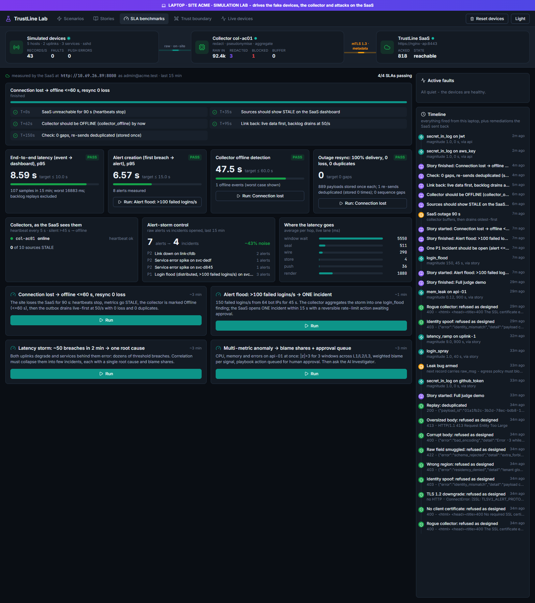

**Evidence: a forced outage with sent and received IDs compared.** Lab › SLA › *Connection lost* cuts the link for 90 s. The SaaS marks the collector offline within 45 s; the buffer drains on reconnect; the resync check compares assigned vs stored sequence numbers and shows `0 gaps`, and every re-send is counted as deduplicated (stored 0 times).

**Evidence: the egress proof log for a specific payload.** Collector UI › Egress proof › click a payload: exact JSON as sent, its sha256, seq, status (sealed → acked / blocked with reason), and the hash-chain link. Paste the `payload_id` into SaaS › Trust Center › audit to see the matching ingest record.

### Phase 4. Final demo, validation and presentation (30 marks)

**Presentation:** [`docs/TrustLine_CICADA2026.pptx`](docs/TrustLine_CICADA2026.pptx), 10 slides following the evaluation guide (problem, data boundary, architecture, security, AIOps, explainability, measured SLAs, live scenarios, roadmap), with speaker notes on every slide.

**End-to-end, raw source to actionable recommendation.** Lab › Stories › *Full judge demo* (7 minutes): a secret in a log (redacted), a leak bug (blocked by the allow-list), a password spray (security finding), a cascading uplink fault (one incident, root cause the link, recommend `failover_uplink`), trust-boundary attacks (refused), then approval and rollback.

**Live scenario response.** Every fault in guide §8 is a one-click scenario with a target, magnitude and duration, so judges can pick what to inject. See the [live scenarios table](#guide-8-live-scenarios-for-final-validation).

**Correctness and few false alarms.** A 5-minute learn-only warm-up; L1 raises only when |z| > 3 in 2 of the last 3 windows and clears after 3 normal windows; L2/L3 only corroborate; a login flood becomes **one** incident instead of 64 per-IP alerts. The overview shows raw alerts vs incidents (noise reduction).

**Explainable recommendations (weighted higher).** Each incident shows: the root-cause source and why the others were rejected; every contributing signal with value, baseline, z-score and weight (`weight = |z| / Σ|z|`); the detection layers that agree; confidence with its parts (`0.5·magnitude + 0.3·agreement + 0.2·persistence`); the matched playbook rule; the reasoning trace (detect → corroborate → correlate → root cause → playbook → policy); the suppressed alerts; and the action's rollback. The **AI Investigator** re-reads that evidence through three read-only tools and writes a plain-English diagnosis that cites each number.

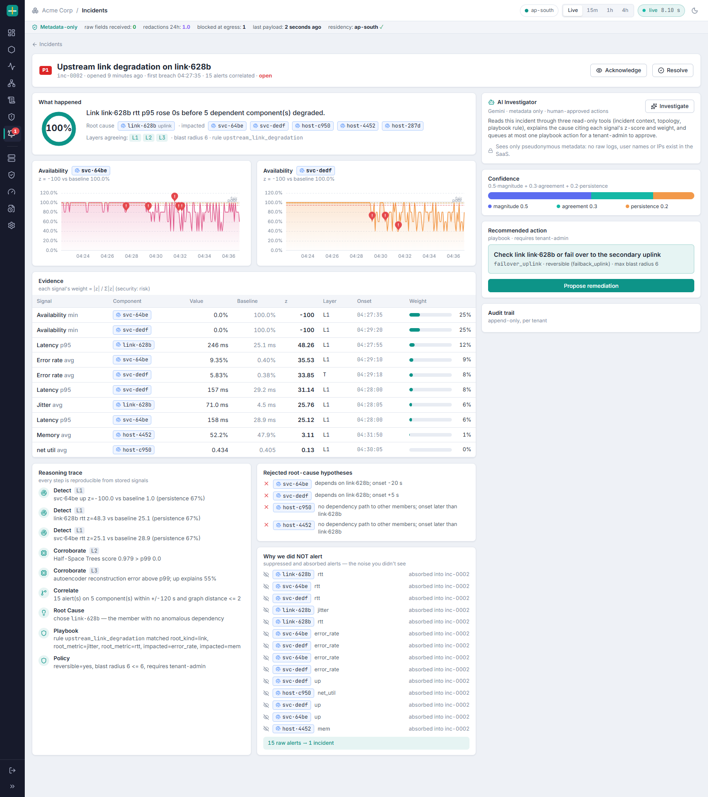

**Limitations.** See [§5](#5-limitations-and-what-production-needs).

**Innovation.** Hash-chained egress proof that the judge can verify; an egress guard after the allow-list (defence in depth); keyed pseudonyms that still allow correlation ("same user, same code"); edge-computed security signals; a trust-boundary attack suite that runs against the real ingest; alert-storm aggregation; SLA verdicts measured by the SaaS itself; and an AI investigator that is policy-bounded (it can only queue the playbook's action, a human approves, rollback recorded).

**Evidence: several alerts merged into one incident.** Run *Latency storm* or *Network cascade*: the uplink, the services routed through it and their hosts degrade within seconds of each other; L4 joins them (graph distance ≤ 2, onset within ±120 s) into one incident with the uplink as root cause and lists the absorbed alerts.

### Guide §4. Four-state health inside the product

| State | Meaning | Rule |
|---|---|---|
| Excellent | healthy | every signal better than its `excellent` threshold |
| Good | normal | worst signal between `excellent` and `good` |
| Fair | needs attention | worst signal between `good` and `fair`, or an open incident on the source, or data stale for 30 s, or config drift |
| Poor | critical | worst signal beyond `fair`, collector without heartbeat for 45 s, link down, or a critical security finding |

Thresholds live in `config/thresholds.yaml` (e.g. CPU p95 60/80/90 %, RTT p95 50/100/200 ms, loss 0.5/1/3 %, error rate 1/2/5 %, disk Poor if < 24 h to full), with per-tenant overrides, editable by a tenant-admin in Settings (audited). Every change writes a UTC-timestamped transition with its reason (e.g. `cpu p95 91.2% ≥ 90 (poor)`), shown in the source's event history. Stale or missing data **downgrades** the state, never shows the last good value.

### Guide §5. AIOps to Autonomous Ops roadmap

| Stage | Built |
|---|---|
| 1. Observe | ✅ health, metrics, events, fleet |
| 2. Detect | ✅ L0 edge security, fast path, L1 baselines, L2 Half-Space Trees, L3 autoencoder |
| 3. Correlate | ✅ L4 topology correlation, root cause, noise reduction |
| 4. Recommend | ✅ L5 playbook recommendation with evidence; AI Investigator |
| 5. Act (future) | ✅ simulated safely: policy check → tenant-admin approval → collector pulls the approved action over mTLS → simulator executes → result reported → verify or roll back, all audited. The collector refuses any action not in its local allow-list |

### Guide §6. Bonus challenges

| Challenge | Demonstration |
|---|---|
| Privacy-aware metadata pipeline | allow-list schema, secret scrubbing, HMAC pseudonyms, egress guard; Lab › *Privacy proof* story |
| Local buffering | outbox with backlog lane; Lab › SLA › *Connection lost* |
| Explainable AIOps | incident evidence, confidence parts, trace, AI Investigator |
| Alert-noise reduction | L4 correlation, persistence/hysteresis, login-flood aggregation; noise ratio on the overview |
| Safe remediation simulation | approval step, audit record, rollback plan; incident page › Remediation |
| Global-ready delivery | UTC + `src_tz`, out-of-order and duplicate scenarios, idempotent retries, residency refusal |

### Guide §7. Questions judges ask

**Exactly what data leaves the local environment, and what stays behind?**
Leaves: metric windows (min/avg/p50/p95/max), security findings (pattern, severity, risk, counts), masked event templates with counts, heartbeats, pseudonymised topology and action results, with pseudonymous source codes only. Stays: raw lines, payloads, secrets, real names and IPs, the HMAC key and code map, the real topology and the egress history.

**How does the collector decide which fields may be sent?**
Default-deny. Stage 6 validates every record against `trustline.v1`; anything that does not fit exactly (extra field, wrong type, a raw identity where a code is required, unsafe text) is blocked and logged with the reason, and consumes no sequence number.

**How do you prevent secrets or raw log content from being transmitted accidentally?**
Three layers: redaction in stage 3 (pattern rules, entropy detector, names), the schema allow-list in stage 6, and the egress guard that re-scans the final payload. Lab › *A code bug adds a raw field* shows the block live.

**How are collectors authenticated and data encrypted?**
Mutual TLS 1.3 with per-collector certificates from the TrustLine CA; identity is the certificate, never the body; revoked serials get 403. Lab › Trust boundary proves rogue CA, no certificate, TLS 1.2, identity spoofing and wrong-region attempts are refused.

**Can you open the egress proof panel and show the last payload?**
Collector UI › Egress proof, top row: exact JSON, sha256, seq, status and hash chain. *Verify chain* recomputes every hash.

**How do you distinguish a real anomaly from a normal usage spike?**
Baselines learn each signal's typical level and spread (median/MAD) per hour of day, so a daily peak is normal. An alert needs |z| > 3 in 2 of 3 windows, so a single spike is ignored; L2/L3 must agree for high confidence; and topology tells an isolated blip from a propagating fault.

**How do you correlate multiple alerts into one incident?**
An alert joins an open incident when its onset is within ±120 s of a member and it is the same source or within graph distance 2 in the dependency graph. The root cause is the member that depends on no other member, earliest onset on ties.

**Can you explain why the platform recommends a particular action?**
The recommendation comes from the first playbook rule whose conditions match (root kind, root metrics, impacted metrics, trend). The UI shows the rule, the matched conditions, the signals and the policy result; the AI Investigator explains it in prose citing the numbers.

**What safeguards are needed before automated remediation?**
Only playbook actions; reversible or explicitly approved; blast radius under the rule's maximum; a tenant-admin approval; the collector online; a local allow-list on the collector; full audit; automatic verification and a one-click rollback.

**What happens when the SaaS is unreachable?**
The collector keeps collecting, sealing and storing payloads in `outbox.db`, probes with backoff, and shows the buffer depth locally. The SaaS marks the collector offline after 45 s without a heartbeat and its sources go stale.

**How do you avoid losing or duplicating metadata after reconnection?**
Byte-identical retries of stored payloads; dedupe by `payload_id` in JetStream and in the database; a set-based sequence ledger that reports gaps; the SLA tab shows 0 gaps and the dedupe count.

**How would you scale across many collectors and tenants?**
Stateless ingest behind nginx, JetStream buffering, per-tenant subjects and consumers, hypertables, per-tenant AIOps state, and one stack per region.

**How do you handle regions, residency, UTC time and out-of-order events?**
Home region per tenant with residency refusal at ingest and reads from the home region only; UTC `event_ts` + `src_tz`; event-time windows with revision re-emits; payload IDs for idempotency.

### Guide §8. Live scenarios for final validation

| Scenario | Trigger in the Lab | What TrustLine shows |
|---|---|---|
| Raw log contains a secret | Scenarios › `secret_in_log` | raw line with secret in the Raw vault; SaaS event shows `<secret:RULE>`; redaction counter |
| Collector loses SaaS connectivity | SLA › *Connection lost* | Fleet: offline < 60 s; buffer grows; drains on reconnect; 0 gaps, 0 duplicates |
| Repeated failed logins | `brute_force`, `login_spray`, `login_flood` | Security: finding with pseudonymous source, risk, counts; never the auth records |
| Network latency rises | `latency_ramp` | uplink Fair → Poor, dependent services degrade, one incident with trend and blast radius |
| CPU or memory deviates from baseline | `cpu_spike`, `mem_leak`, SLA › *Multi-metric anomaly* | incident with z-scores, layers agreeing, recommendation "investigate" or restart |
| Several alerts relate to one incident | SLA › *Latency storm*, Stories › *Network cascade* | N alerts → 1 incident, affected components listed, noise ratio |
| Duplicate or out-of-order delivery | `dup_burst`, `out_of_order`, `clock_skew` | charts ordered by event time; duplicates dropped; counters in Fleet |
| Remediation is proposed | incident › Propose / Investigate | policy check, approval, audit trail, execution result, rollback |

### Mandatory items

| Item | Status |
|---|---|
| Real-time targets measured from timestamps | ✅ SLO page and Lab › SLA benchmarks |
| Organiser-provided stream | ⚠️ no stream was provided; the collector has a configurable organiser adapter and the simulator is clearly labelled as simulated |
| Egress proof panel | ✅ Collector UI › Egress proof |

---

## 3. How every part works

### 3.1 Simulator and Simulation Lab (Tier 1, `simulator/`)

A seeded simulator generates a small company site: hosts `web-01`, `web-02`, `api-01`, `db-01`, `gw-01`; services `web`, `api`, `db`; uplinks `uplink-1`, `uplink-2`. It emits 1-second metric samples, probe results, HTTP checks, application logs and sshd/PAM auth syslog, pushed to the collector on :8081 and :5514. Faults follow the topology: a slow uplink makes the services routed through it error after about 75 s.

Fault types (target, default magnitude, duration): `cpu_spike`, `mem_leak`, `disk_fill`, `latency_ramp`, `packet_loss`, `link_down`, `service_errors`, `login_spray`, `brute_force`, `login_flood` (150 failed logins/s from 64 IPs), `success_after_failures`, `secret_in_log`, `dup_burst`, `out_of_order`, `clock_skew`. It also obeys remediation actions (`failover_uplink`, `restart_service`, `block_source_ip`, `enable_auth_rate_limit`, … and their rollbacks) and writes ground truth to `ground_truth.jsonl`.

The **Simulation Lab** (:8090) drives everything from the site laptop:

- **Scenarios:** every fault with target, magnitude and duration, plus the collector leak bug and SaaS-outage switches.

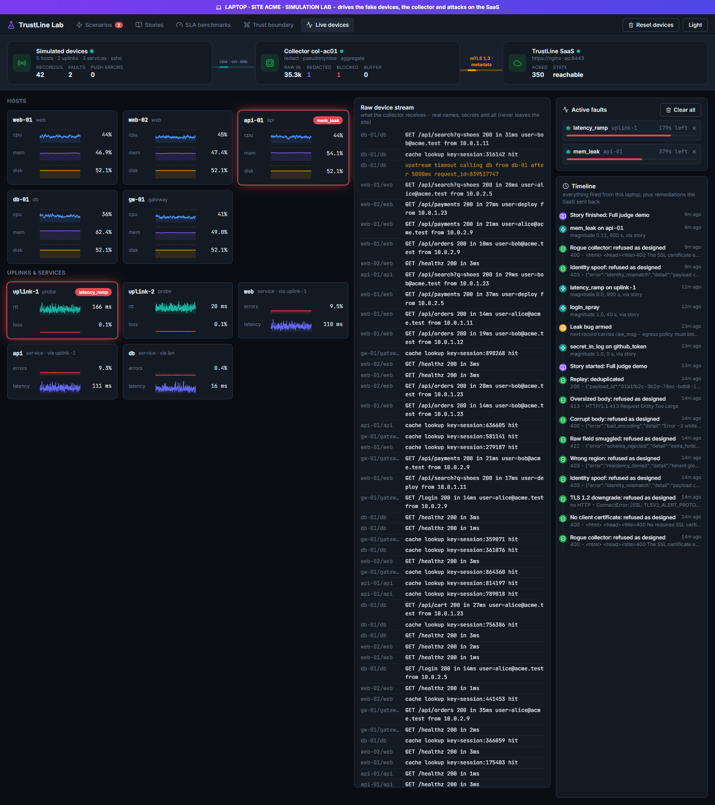

- **Stories:** scripted runs: full judge demo, privacy proof, network cascade, attack chain, delivery resilience, trust-boundary gauntlet, noisy day.

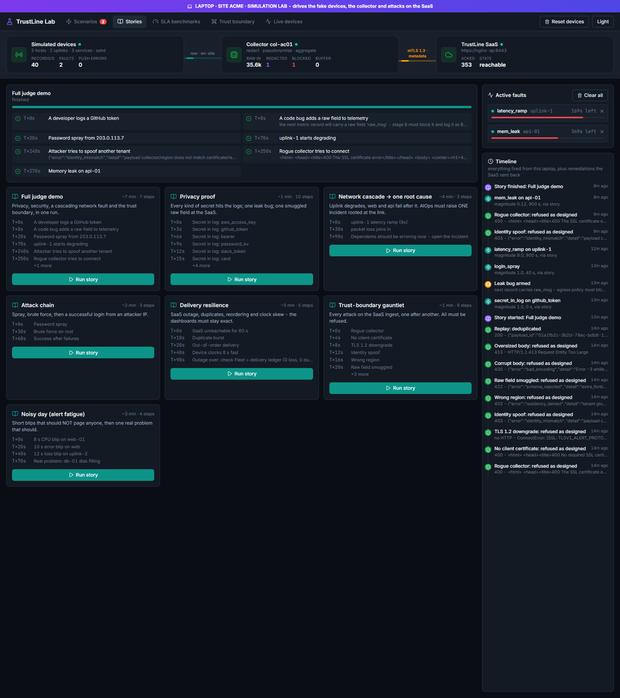

- **SLA benchmarks:** logs in to the SaaS as a tenant user and scores the SaaS's own measurements: end-to-end p95 ≤ 10 s, alert ≤ 15 s, offline detection ≤ 60 s, resync with 0 loss and 0 duplicates. One-click scenarios: *Connection lost* (90 s), *Login flood*, *Latency storm*, *Multi-metric anomaly*.


- **Trust boundary:** 9 real attacks against the SaaS ingest, each of which must be refused (or deduplicated, for the replay).

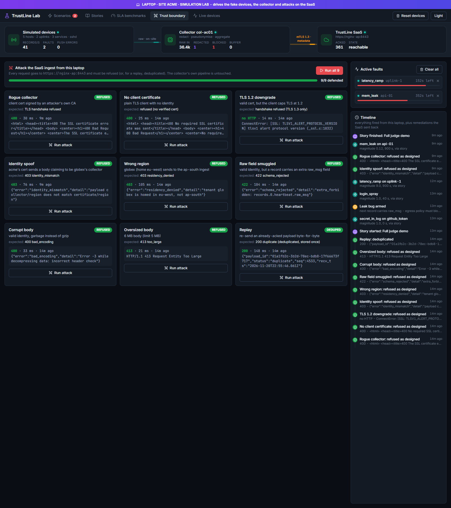

- **Live devices:** per-second charts of every device and the raw stream.

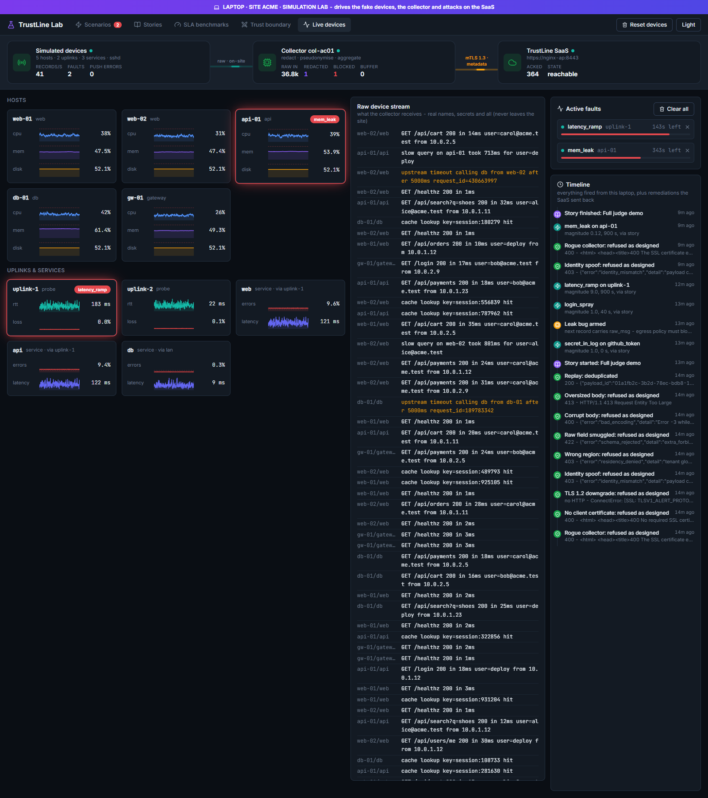

### 3.2 Collector (Tier 1, `collector/`)

One async Python process with seven stages:

| Stage | File | What it does |
|---|---|---|
| 1 Collect | `s1_collect.py` | stamps `collect_ts`; stores the original line in `raw.db` (site only, 7 days) |
| 2 Filter | `s2_filter.py` | parses JSON and sshd/PAM syslog into fields; drops noise; 10-minute TTL dedupe of source events |
| 3 Redact | `s3_redact.py`, `redact/` | secret rules → entropy detector → HMAC pseudonyms → name spotter → template; secret spans written back to `raw.db` for the raw viewer |
| 4 Aggregate | `s4_aggregate.py` | 5 s tumbling windows by event time: min/avg/p50/p95/max; jitter from RTT; disk hours-to-full from the slope; template counts; late samples re-emit with `rev+1` |
| 5 Analyse | `s5_analyse.py` | fast path: 3 consecutive 1 s samples beyond Poor → immediate `threshold_breach` finding with `breach_ts`; L0 security on raw auth records per pseudonymous IP over 60 s: brute force (≥ 10 failures), spray (≥ 5 users), success after ≥ 5 failures, site-wide **login flood** (≥ 100 failures/s → one aggregate finding, per-IP findings suppressed); robust z attached to every finding |
| 6 Policy | `s6_policy.py` | schema validation (default-deny), blocked records logged with reason; egress guard on the assembled payload; high/critical findings flush immediately, the rest every 1 s |
| 7 Transmit | `s7_transmit.py` | one SQLite transaction allocates `seq`, stores the gzip body in `outbox.db` and appends the `sealed` entry to the hash chain; live lane + backlog lane over mTLS; ack → `acked`, refusal → `rejected` |

Local stores (SQLite, WAL): `raw.db`, `egress.db` (hash chain), `outbox.db` (survives restarts, 500 MB cap), `state.db` (seq counter, code → name map). Heartbeats every 5 s report version, config hash, CPU/memory, buffer depth/bytes, last acked/assigned seq, redaction/block/dup/late counters and whether the SaaS is reachable. Approved remediation actions are pulled over the same mTLS door and checked against the local `actions_allowlist` before they run.

The **local UI** (:9090, bound to 127.0.0.1) is only on the site:

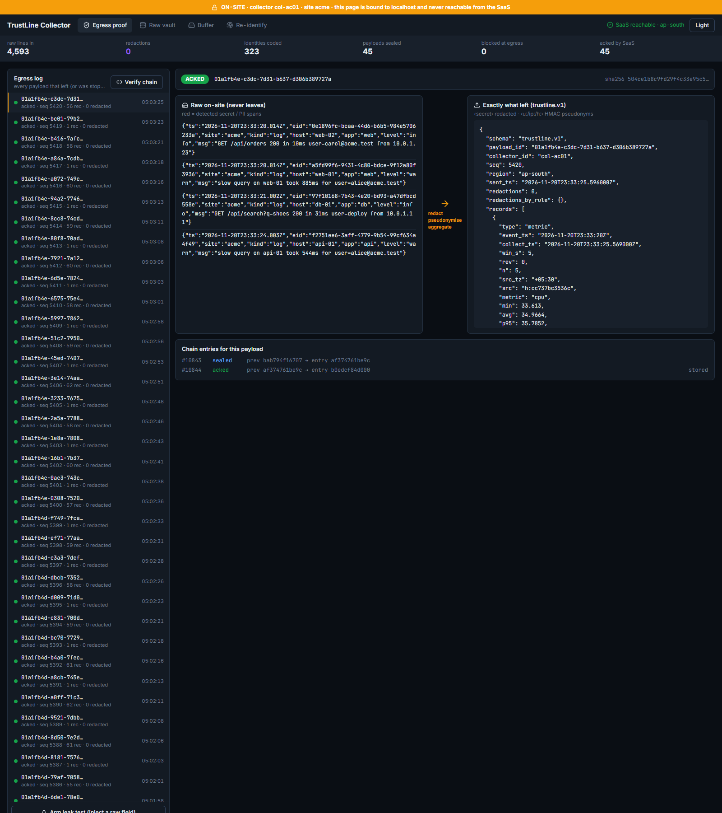

- **Egress proof:** every payload that left (or was stopped), exact JSON, sha256, status and the hash chain with a *verify* button.
- **Raw vault:** original lines with removed secrets highlighted.

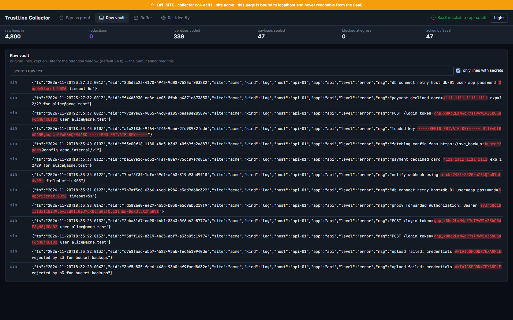

- **Buffer:** outbox depth, live vs backlog lane, backoff state.

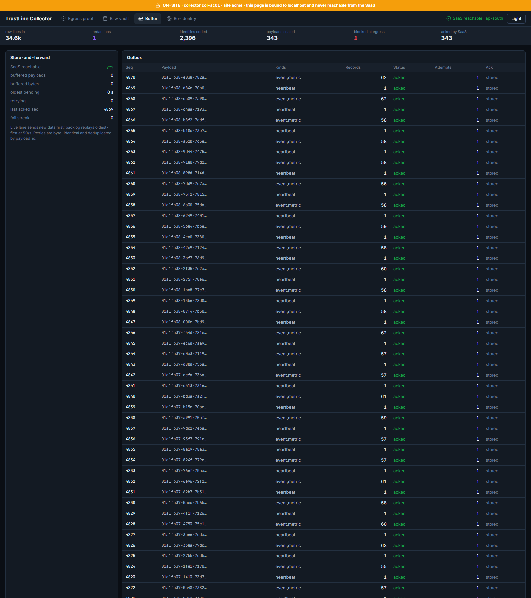

- **Re-identify:** turn a pseudonym from the SaaS back into the real name, on site only.

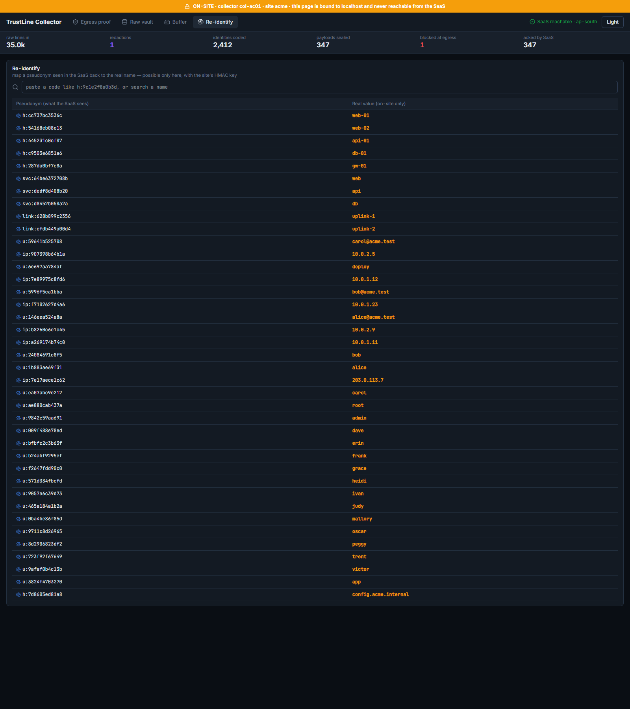

### 3.3 The trust boundary and ingest (Tier 2, `deploy/nginx`, `saas/ingest`)

nginx terminates mutual TLS 1.3 (`ssl_verify_client on`, TLS 1.3 only, 5 MB body limit) and forwards the verified certificate subject as `X-Client-DN`, overwriting anything the client sent. `ingest-api` is stateless:

1. require a verified certificate; derive tenant and collector from the DN;
2. refuse revoked serials (registry from the control plane, refreshed every 10 s);
3. refuse a tenant outside this region (`403 residency_denied`);
4. gunzip with a bound, validate against `trustline.v1` (`422 schema_rejected`);
5. refuse a body whose `collector_id`/`region` does not match the certificate (`403 identity_mismatch`);
6. publish to JetStream `ingest.<region>.<tenant>` with `Nats-Msg-Id = payload_id`, and ack only after JetStream confirms (`stored` or `duplicate`);
7. write an audit row and update the collector's last-seen time and clock skew.

### 3.4 Storage, health and the sweeper (`saas/workers`, `deploy/db`)

The **writer** consumes JetStream, inserts `received_payloads` (`ON CONFLICT (payload_id) DO NOTHING`), bulk-inserts records by type (metric windows upsert by `(tenant, src, metric, event_ts)` keeping the highest `rev`), commits, acks and publishes a live event for the dashboard. All of it runs inside a tenant-scoped transaction under RLS.

**Health** evaluates every metric window against the thresholds; a source's state is its worst signal, at least Fair while an incident is open. Every change writes a transition with the reason. The **sweeper** runs every 2 s: no data for 30 s drops a source one level and marks it stale; no heartbeat for 45 s makes the collector and its sources Poor; a config hash that differs from the expected one marks config drift. A set-based **ledger** reports sequence gaps that stay unfilled for 120 s.

### 3.5 AIOps engine (L0-L5)

| Layer | Where | Technique |
|---|---|---|
| T | collector | fast-path threshold breach on raw 1 s samples (3 consecutive) |
| L0 | collector | security rules + Isolation Forest risk on raw auth records, login-flood aggregation |
| L1 | `aiops/baseline.py` | per (tenant, source, metric): median/MAD of the last 120 windows, hour-of-day buckets after 30 values, EWMA; robust `z = (x − median) / (1.4826·MAD + ε)`; warm-up, 2-of-3 persistence, 3-window clear |
| L2 | `aiops/models.py` | streaming Half-Space Trees (`river`) on each host's feature vector, threshold at its own rolling p99 |
| L3 | `aiops/models.py` | neural autoencoder (scikit-learn `MLPRegressor` 5→8→2→8→5) on the tenant's vectors; threshold at the p99 reconstruction error; per-feature contribution |
| L4 | `aiops/correlate.py` | `networkx` graph from the pseudonymised topology; ±120 s and graph distance ≤ 2; auth alerts of the same campaign merge; root cause = most upstream member |
| L5 | `aiops/explain.py` | first matching playbook rule → action, rationale, policy; `weight = |z_i| / Σ|z|`; `confidence = 0.5·min(1, max|z|/8) + 0.3·layers/3 + 0.2·persistence`; reasoning trace and suppressed alerts |

Priority: P1 critical, blast radius ≥ 4 or success-after-failures; P2 high or blast radius ≥ 2; P3 medium; P4 the rest. Playbook rules (`config/playbook.yaml`): `upstream_link_degradation`, `link_down`, `memory_leak`, `cpu_saturation`, `disk_fill`, `login_flood`, `auth_attack`, `service_errors`, `generic_anomaly`.

### 3.6 Remediation (safe, simulated Autonomous Ops)

`proposed` (only if the policy check passes) `→ approved / rejected → dispatched → executed → verified`, or `→ rolled_back`. The policy check requires a playbook action, reversibility or explicit approval, blast radius within the rule's maximum, the approver's role, and an online collector. The collector pulls approved actions outbound, checks its local allow-list, the simulator executes them and an `action_result` record comes back. Verification waits for the root cause to be Good for 3 windows; otherwise rollback is offered. Every step is in the audit log.

### 3.7 AI Investigator (`saas/api/api/investigator.py`)

On an incident, **Investigate** runs an SRE agent over metadata only. It calls three read-only tools under the tenant's RLS: `get_incident_context`, `query_topology` and `fetch_playbook_rule`, then submits a structured diagnosis: summary, root cause with reasoning, citations (source, metric, value, baseline, z, weight, role), layers agreeing, confidence, recommended action, rollback plan, risk and caveats. It may queue at most one action and only the incident's own playbook action, as `proposed` for a tenant-admin to approve; anything else is refused by policy and recorded. Every run is audited.

Engines: Gemini (function calling over REST, with model fallbacks on overload), Claude (Messages API with tools), or a deterministic engine that runs the same tools in code. Any API failure falls back to the deterministic engine, so the button always answers.

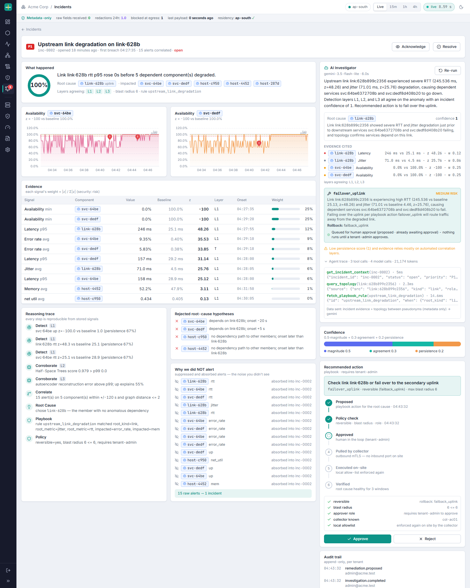

### 3.8 API, auth and isolation (`saas/api`)

FastAPI. Login with scrypt-hashed users and an 8-hour HS256 JWT carrying `tenant`, `role` and `region`. Every request opens a tenant-scoped transaction on the tenant's home-region database (`SET app.tenant_id`), so RLS applies to every query. A WebSocket pushes live updates; the dashboard groups them into one refresh every 2.5 s at most and charts update in place. Render acknowledgements feed the latency samples behind the SLO page.

### 3.9 Control plane and PKI (`saas/control`, `deploy/certs`)

Holds no telemetry: the tenant registry (home region, collectors), the CA, one-time-token enrolment (CSR → 7-day client certificate) and the revocation list. The CA private key exists only here.

### 3.10 SaaS dashboard pages

| Page | Shows |
|---|---|
| Overview | KPIs, health state counts, open incidents, noise ratio, redactions, SLO p95s |
| Infrastructure | every host, service and link with state, reason and sparkline |
| Metrics | any metric with its learned baseline band and threshold lines |
| Service map | the pseudonymised dependency graph coloured by health |
| Events | masked templates with counts, facets, search |
| Security | edge security findings with risk and pseudonymous sources |
| Incidents | correlated incidents; detail with evidence, trace, remediation, AI Investigator |
| Fleet | collectors: online/offline, last seen, version, config hash, CPU/memory, buffer, delivery ledger |
| Trust Center | trust boundary counters, payload audit lookup, cross-tenant isolation test, residency |
| SLO | p50/p95/max against targets and the per-hop latency waterfall |
| Audit | every login, ingest decision, threshold change, remediation and investigation |
| Settings | thresholds editor (tenant-admin, audited) |

<table>
<tr><td>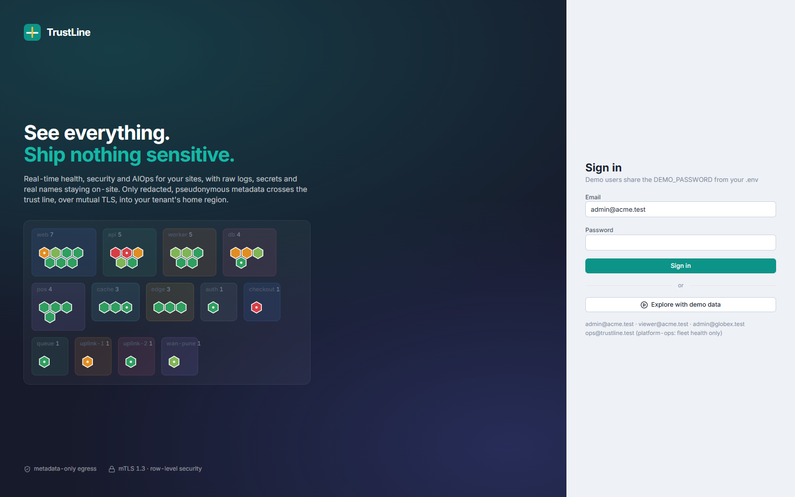</td><td>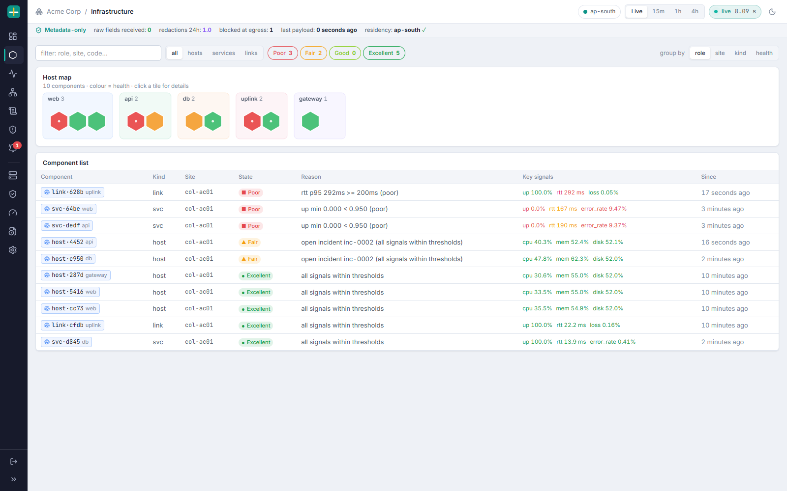</td></tr>
<tr><td>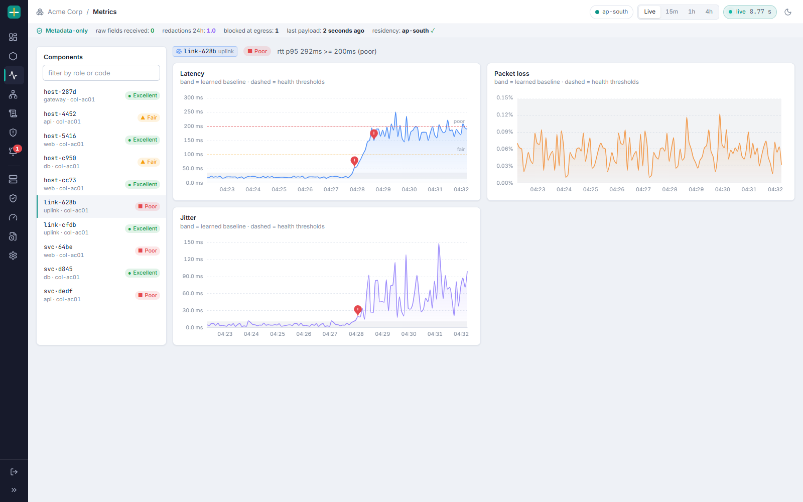</td><td>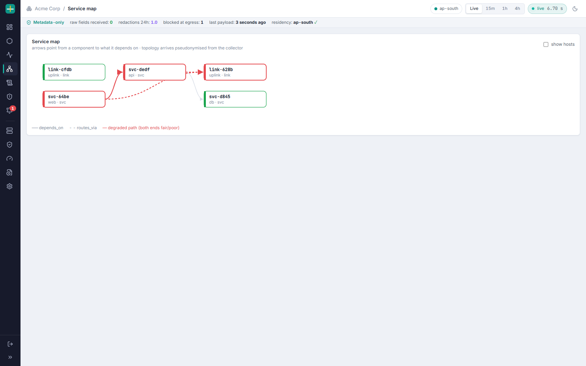</td></tr>
<tr><td>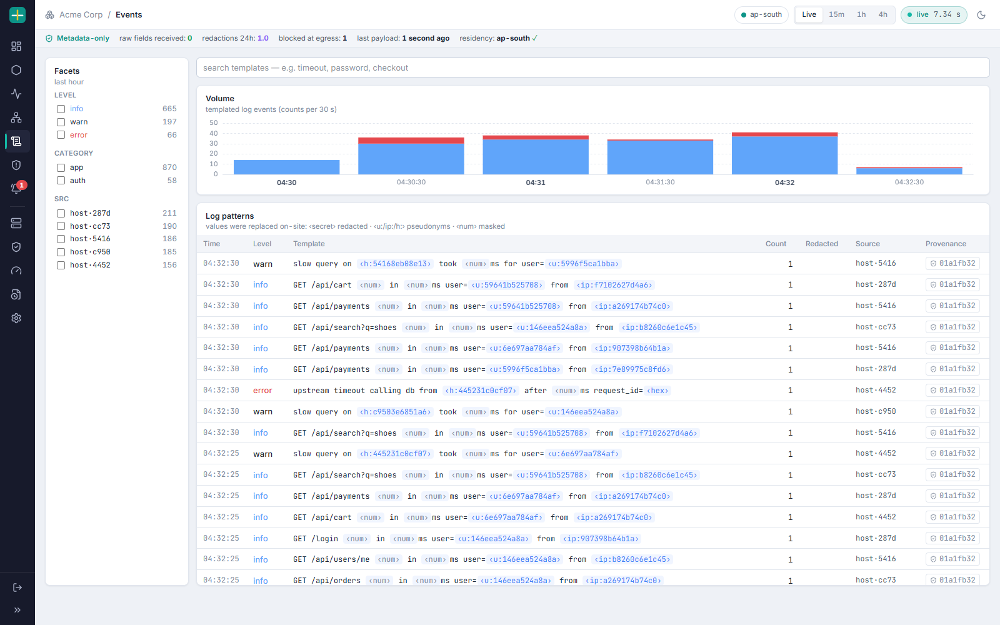</td><td>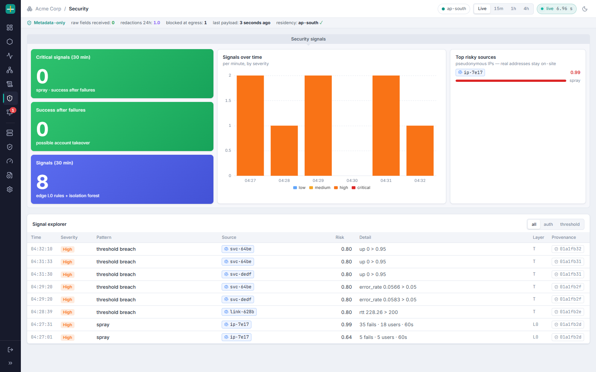</td></tr>
<tr><td>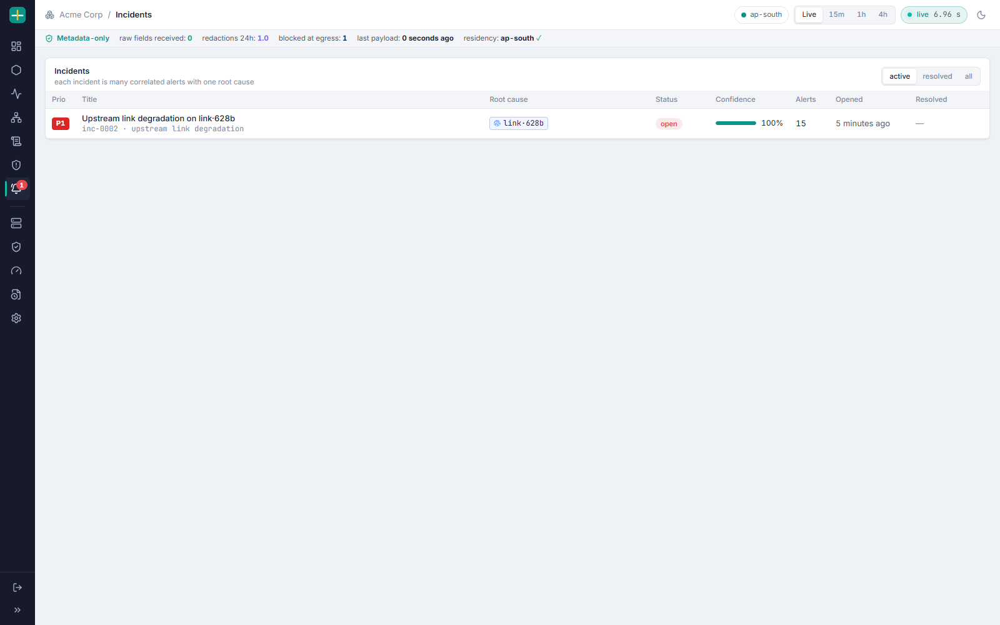</td><td>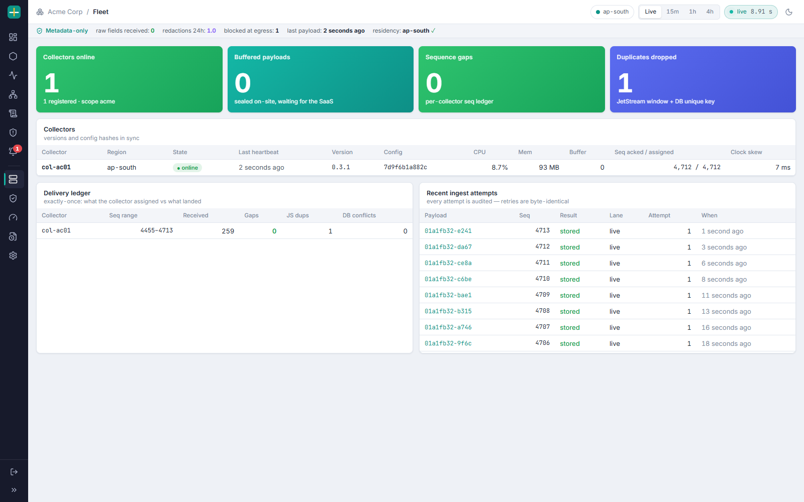</td></tr>
<tr><td>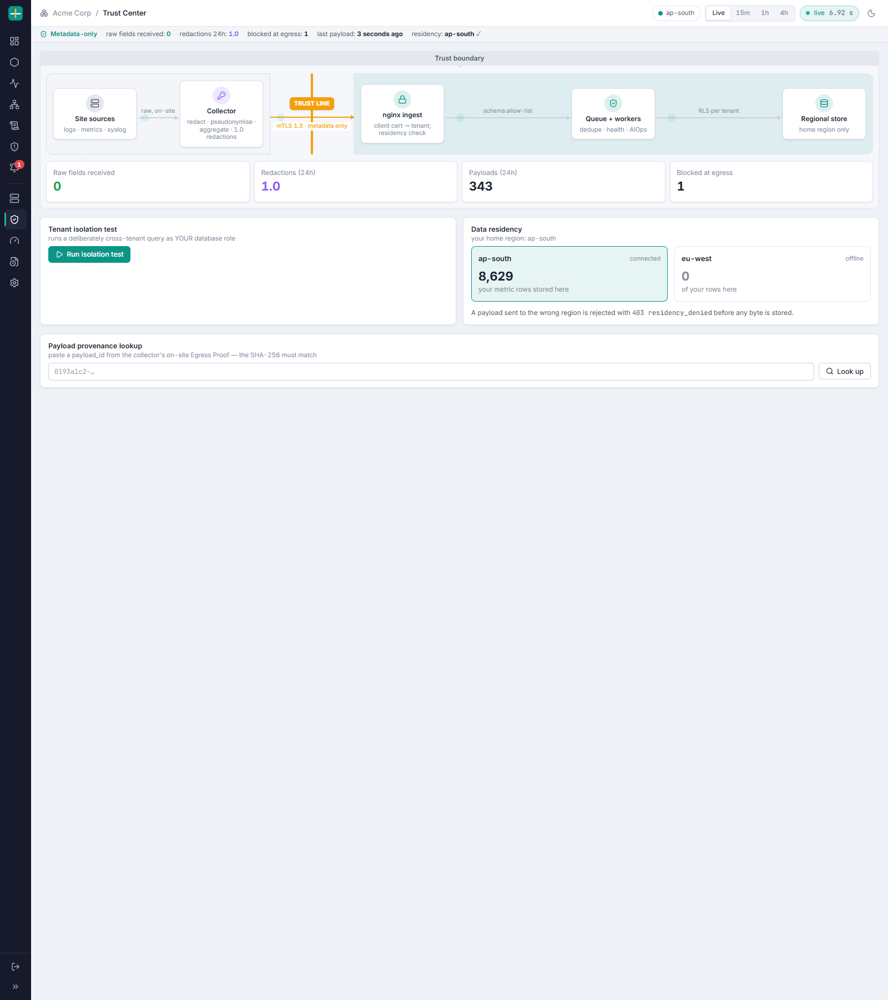</td><td>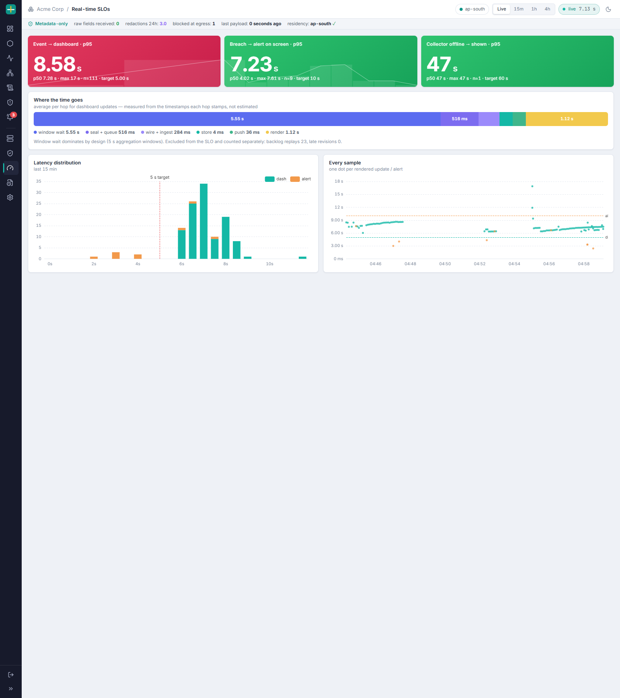</td></tr>
<tr><td>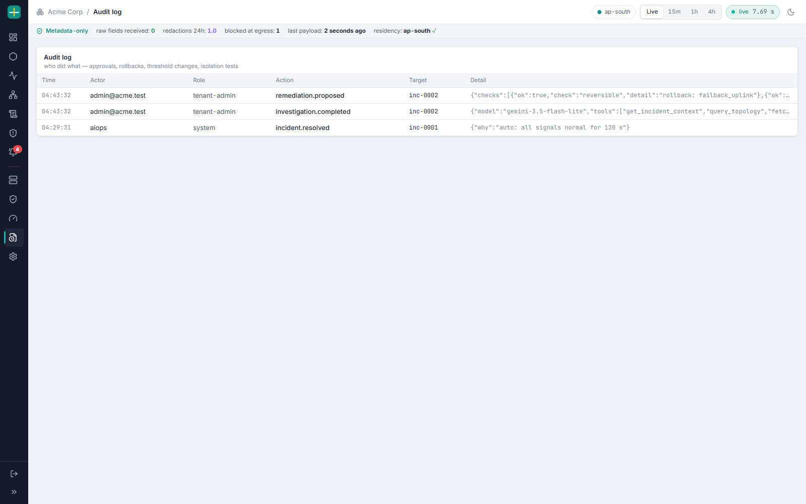</td><td>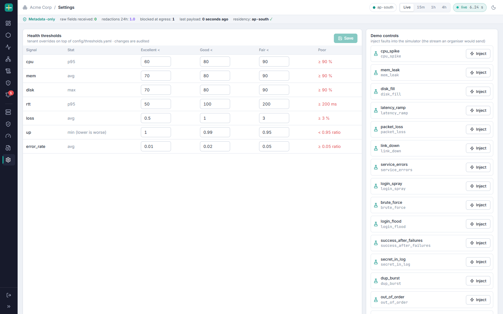</td></tr>
</table>

---

## 4. Specifications

### Wire format `trustline.v1` (`schema/`, version 1.1.0, frozen)

Payload: `schema`, `payload_id` (UUIDv7), `collector_id`, `seq`, `region`, `sent_ts` (UTC, sealed time, immutable across retries), `redactions`, `redactions_by_rule`, `records[1..500]`. There is no tenant field: the tenant is the certificate.

| Record | Key fields |
|---|---|
| `metric` | src code, metric (`cpu, mem, disk, disk_hours_to_full, net_in, net_out, net_util, rtt, jitter, loss, up, error_rate`), window 1/5/60 s, min/avg/p50/p95/max, unit, `rev` |
| `finding` | category (`auth, threshold, anomaly, connectivity`), pattern (`brute_force, spray, success_after_failures, login_flood, threshold_breach, edge_anomaly, link_down`), layer (L0/T), severity, risk 0-1, z, counts, `breach_ts` |
| `event` | category, level, masked template id + text, count per window |
| `heartbeat` | version, config hash, CPU, memory, buffer depth/bytes, last acked/assigned seq, counters, `saas_reachable` |
| `topology` | nodes (code, kind host/svc/link, role) and edges (depends_on, runs_on, routes_via) |
| `action_result` | action id, status (`executed, failed, rolled_back, refused_local_policy`) |

### Ports

| Port | Process | Exposed |
|---|---|---|
| 8443 | nginx mTLS ingest | LAN / tunnel (the only data door) |
| 8000 | API + SaaS dashboard | LAN / tunnel |
| 8001, 8010, 8444, 4222, 8222, 5432 | ingest, control (internal, enrolment), NATS, NATS monitor, Postgres | 127.0.0.1 only |
| 8081, 5514/udp | collector push, syslog | site only |
| 9090 | collector local UI | 127.0.0.1 |
| 8090 | Simulation Lab | 127.0.0.1 (`--lab-host` to change) |

### Configuration

| File | Purpose |
|---|---|
| `config/collector.yaml` | window 5 s, batch 1 s, heartbeat 5 s, late horizon 120 s, retention, outbox cap, backoff, redaction, security thresholds, action allow-list |
| `config/thresholds.yaml` | four-state thresholds per signal, stale 30 s, offline 45 s, tenant overrides |
| `config/playbook.yaml` | rule conditions, action, rationale, reversibility, rollback, approver role, max blast radius |
| `config/tenants.yaml` | tenants, home regions, collectors, revoked serials |
| `config/organiser_mapping.yaml` | organiser stream transport and field mapping |
| `config/sites/<site>/topology.yaml` | real topology, Tier 1 only |

### Real-time design budget

5 s windows + 0.5 s grace + ≤ 1 s batch + transport/store/push ≈ 6.5 s p95 to the dashboard (target 10 s). Threshold breaches skip the window: 3 s of samples, then an immediate flush (target 15 s). Offline after 45 s without a heartbeat, checked every 2 s (target 60 s).

### Tech stack

Python 3.12/3.13 (FastAPI, uvicorn, httpx, Pydantic, asyncpg, nats-py, numpy, scikit-learn, river, networkx, cryptography), NATS JetStream 2.15, PostgreSQL 17 (TimescaleDB when available) with row-level security, nginx 1.30 for mutual TLS, React 19 + Vite 7 + TanStack Query + ECharts for the dashboards, SQLite for the collector's local stores.

### Tests

`python scripts/tl.py test unit`: collector 41, schema 12, simulator 7, AIOps 10, AI Investigator 5 (75 in total), covering redaction, allow-list blocking, egress guard, windows and late data, fast path, security detectors and the login-flood aggregation, outbox and idempotent retries, baselines (step, daily cycle, blip, flapping), correlation and root cause, confidence, playbook selection, the investigator's tool loop and policy bound, the incident-route regression, and secret highlighting in the Raw vault.

### Repository layout

```
schema/        trustline.v1 wire contract (frozen)
collector/     Tier 1 collector: stages, redaction, stores, sources, local UI API
simulator/     device simulator, Simulation Lab API, SLA and trust-boundary tests
saas/          ingest, control, workers (writer, health, AIOps), api (+ AI Investigator)
dashboard/     React apps: SaaS dashboard, collector local UI, Simulation Lab
deploy/        PKI script, nginx, NATS, DB schema + RLS, Colab notebook
config/        collector, thresholds, playbook, tenants, organiser mapping, site topology
scripts/       tl.py (Docker workflow), native.py (no Docker: Colab, LAN, Windows)
docs/          implementation plan, ADRs, presentation, screenshots
```

---

## 5. Limitations and what production needs

- **No organiser stream was provided.** Everything runs on our simulator; the organiser adapter is ready but untested against a real feed.
- **One region outside Docker.** LAN and Colab modes run `ap-south` only; residency is enforced (globex is refused) but the eu-west stack runs only with Docker `--full`.
- **Dashboard over HTTP on the LAN.** The data path (H2) is mutual TLS; the browser path should be HTTPS with a real certificate in production.
- **Demo PKI.** The CA lives on the server; production needs an HSM or a managed CA, short-lived certificates with automatic renewal, and OCSP/CRL at the TLS layer (today a revoked serial is refused at ingest with 403).
- **Small models.** Baselines need a 5-minute warm-up; the autoencoder is a small scikit-learn network. Production needs longer history, seasonal models and continuous evaluation of precision and recall.
- **Remediation is simulated.** Real actions need adapters per device type, dry runs and change windows.
- **AI Investigator sends metadata to an external model** when a key is set. Production would use an in-region model endpoint or keep the deterministic engine.
- **Scale untested.** The design scales horizontally, but it was exercised with one or two collectors.

## 6. Repository rules

- `others/`, `.env`, `config/users.yaml`, `deploy/certs/out/`, `.run/` and `dist/` are gitignored. Never commit them; `dist/*.zip` contain secrets.
- `schema/` is the frozen contract: change it only with a version bump.
- Tier-1 files (`config/sites/*`, HMAC keys) belong only on the site.
